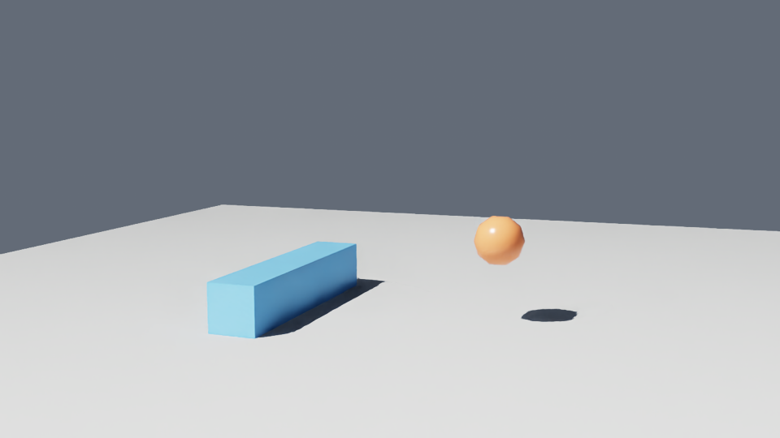

# ovfmi OpenUSD mapping: bouncing ball

How an FMI 2.0 co-simulation unit is wired into an OpenUSD file with [ovfmi](https://pypi.org/project/ovfmi/). The `BouncingBall` FMU (from [Reference-FMUs](https://github.com/modelica/Reference-FMUs)) is described by three prim types authored next to the scene it drives.

- `bouncing_ball.usda` – the ball and the FMU mapping, annotated
- `run_bouncing_ball.py` – steps the FMU for 4 s at 60 Hz and prints every mapped attribute
- `bake_trajectory.py` – steps the FMU for 5 s and writes `bouncing_ball_baked.usda`
- `bouncing_ball_baked.usda` – the baked result: 301 time samples at 60 fps for `xformOp:translate` and `sim:velocity`, playable without the FMU
- `bouncing_ball_live.usda` – both mappings (bouncing ball and rotator) plus floor, lights, camera and an ovrtx render product
- `viewer_app.py` – live [ovui](https://github.com/NVIDIA-omniverse/ovui) app: ovfmi steps both FMUs, ovrtx renders `bouncing_ball_live.usda`
- `fmus/BouncingBall.fmu` – the model
- `rotator.usda`, `run_rotator.py` – a second mapping: a `Rotator` FMU drives the Y rotation of a box (see below)
- `fmu_src/Rotator/`, `build_rotator_fmu.py`, `fmus/Rotator.fmu` – source, build script and result of the Rotator FMU

## The mapping

```
FmuInstance  /BouncingBallFmu            fmi:fmu = ./fmus/BouncingBall.fmu
└─ FmuConnection  BallConnection         fmi:targets = </World/Ball>
   ├─ FmuMapping  HeightToY              h   ──▶ xformOp:translate (y only)
   ├─ FmuMapping  VelocityOut            v   ──▶ sim:velocity
   └─ FmuMapping  RestitutionIn          e   ◀── sim:restitution
```

| FMU variable | Causality | `fmi:direction` | `fmi:usdAttribute` | `fmi:usdMapping` |
| --- | --- | --- | --- | --- |
| `h` | output (m) | `output` (FMU → USD) | `xformOp:translate` | `(1, 1)`: y of a `double3` |
| `v` | output (m/s) | `output` | `sim:velocity` | `(0, 1)`: the scalar |
| `e` | tunable parameter, 0.5 to 1 | `input` (USD → FMU) | `sim:restitution` | `(0, 1)`: the scalar |

Not mapped: `g` (fixed parameter), `v_min` (constant), `time`, `der(h)`, `der(v)`.

- `FmuInstance` holds the FMU file and an on/off switch (`fmi:enabled`).
- `FmuConnection` lists the prims (`fmi:targets`) that every child mapping applies to. The tensors ovfmi returns have one row per target.
- `FmuMapping` ties one FMU variable (`fmi:fmuAttribute`) to one USD attribute, with a direction and a component range (`fmi:usdMapping`).

`sim:velocity` and `sim:restitution` are custom attributes authored on the ball, so the mapping is visible in the file and any other tool can read or edit them.

## Run

Python 3.10 to 3.13.

```powershell
uv venv --python 3.12 .venv
uv pip install --python .venv\Scripts\python.exe -r requirements.txt
.venv\Scripts\python.exe run_bouncing_ball.py
```

Expected output: the height falls from 1 m, bounces with decreasing peaks, and at t≈0.5 s the script writes `sim:restitution = 0.95` so the following bounces stay higher.

```
t=0.017s  h= 0.999 m  v= -0.157 m/s
t=0.350s  h= 0.401 m  v= -3.434 m/s
-- writing sim:restitution = 0.95
t=0.517s  h= 0.177 m  v=  2.493 m/s
```

## Bake the trajectory

```powershell
.venv\Scripts\python.exe bake_trajectory.py
```

Each step reads the mapped outputs with `fmi.read()` and authors them as time samples with `pxr` (`usd-core`). `sim:restitution` stays constant at the FMU default 0.7.

## Live viewer (ovui + ovrtx)

Needs Python 3.12 (the ovui wheels are `cp312`), Windows or Linux with an NVIDIA RTX GPU and a current driver.

```powershell
.venv\Scripts\python.exe viewer_app.py
```



Each frame ovfmi steps both FMUs and writes their outputs into the ovstage that ovrtx renders: `h` and `v` of the bouncing ball, `angle` and `omega` of the blue rotor bar. `h` and `v` are plotted under the viewport, the rotor's angle and omega are shown in the second control row.

| Control | Does |
| --- | --- |
| Pause / Play, Reset | stop the simulation, restart the FMU |
| Speed | scales the simulation step (0.1x to 2x) |
| Restitution e | writes the ball FMU input `e` through the USD attribute `sim:restitution` |
| Rotator: on, Speed, Acceleration | write `sim:enabled`, `sim:speed` and `sim:acceleration` on `/World/Rotor`, the inputs of the Rotator FMU |
| Left-drag in the viewport | orbit the camera |
| Right-drag or mouse wheel | zoom |

Both FMUs restart every 8 s of simulation time (the rotor angle jumps back to 0). Options: `--frames N --snapshot out.png`. The first start compiles shaders (a few minutes).

## Rotator FMU

A small FMI 2.0 co-simulation FMU written for this example (Reference-FMUs template, C, built with MSVC; the FMU contains a win64 binary only).
It rotates a box about Y: the angle advances with a speed plus a constant acceleration, and can be switched off.

| FMU variable | Causality | `fmi:direction` | `fmi:usdAttribute` |
| --- | --- | --- | --- |
| `angle` (deg, not wrapped) | output | `output` (FMU → USD) | `xformOp:rotateXYZ`, y component via `usdMapping (1, 1)` |
| `omega` (deg/s) = `speed` + `acceleration` · t | output | `output` | `sim:omega` |
| `speed` (deg/s, start 90) | input | `input` (USD → FMU) | `sim:speed` |
| `acceleration` (deg/s², start 0) | input | `input` | `sim:acceleration` |
| `enabled` (Boolean, start true) | input | `input` | `sim:enabled` |

`enabled = false` freezes the angle and the speed gained so far. ovfmi applies every input mapping on every step, so the inputs are levels: writing `speed` changes the rate immediately and does not reset what the acceleration has added.

```powershell
.venv\Scripts\python.exe run_rotator.py                 # steps 4 s, changes the three inputs on the way
.venv\Scripts\python.exe build_rotator_fmu.py           # rebuild fmus/Rotator.fmu (needs Visual Studio C++ build tools)
```

The solver is the template's fixed 1 ms forward Euler step, so the angle drifts slightly from the analytic value (0.05 deg after 2 s at 45 deg/s²).

## Notes

- ovfmi 0.2.0 is pre-release; the API and schema may change.
- `attach_ovstage` needs `source_asset`: the custom FMI prims are not visible in the ovstage population, so ovfmi parses the original USD file itself.
- Keep the FMU-driven attributes on the prim that is rendered. ovstage does not propagate a parent's FMU-driven translate to child prims.
- For a live ovrtx viewer and a baked time-sampled file built on the same mapping, see [`../ovfmi`](../ovfmi).
- In the live viewer, ovrtx renders the ball's FMU-driven `xformOp:translate` directly but does not re-evaluate the FMU-driven rotation: the bar stayed still. `viewer_app.py` therefore also writes the FMU angle into the rotor's `omni:xform` matrix every frame, the same way it drives the camera. The FMU mapping itself is unchanged.
