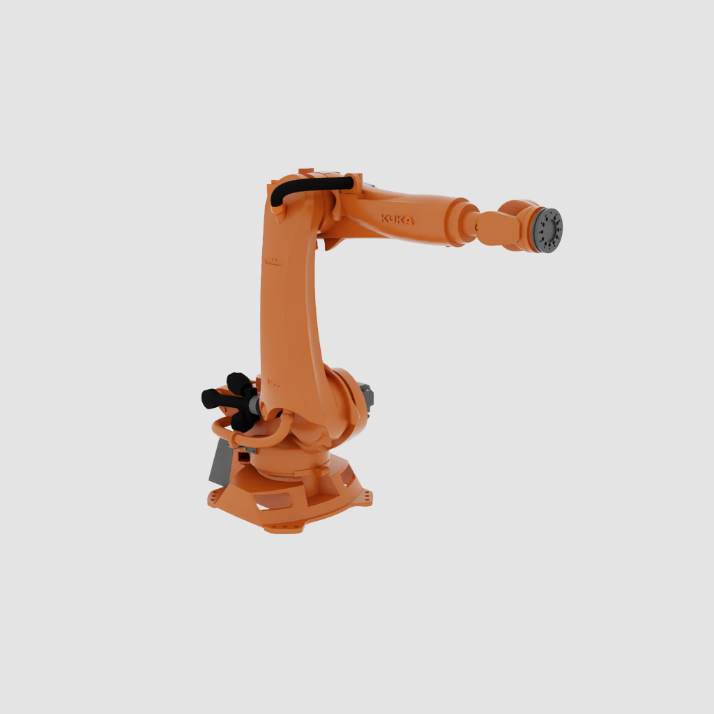
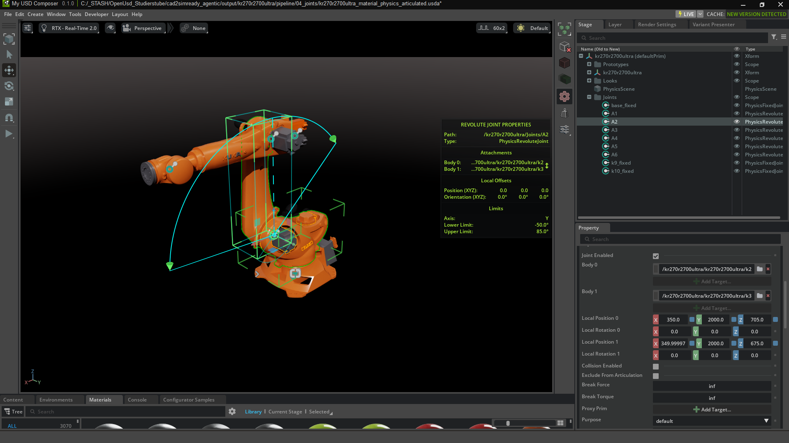
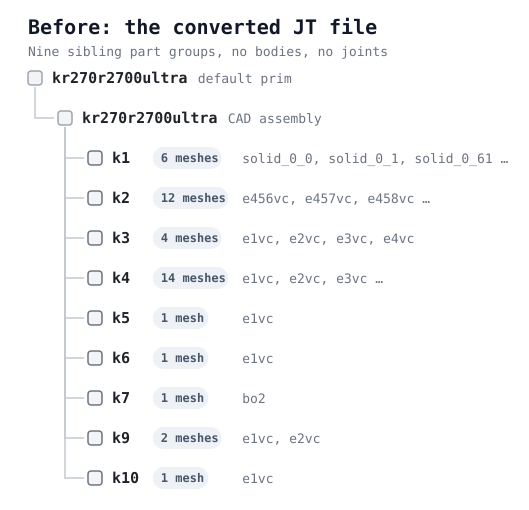
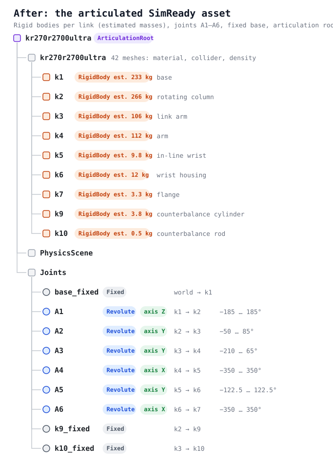

# SimReady robot from a JT file

A KUKA KR 270 R2700 ultra JT file turned into a SimReady OpenUSD asset with AI agents: NVIDIA's
[`omniverse-cad-to-simready`](https://github.com/nvidia/skills) skill driven by Claude Code, the
[USD Content Agents](https://github.com/nvidia-omniverse/content-agents) for materials and physics, and a
datasheet-based rig for the joints.



## Result

The articulated asset in USD Composer, joint A2 selected (revolute about Y, k2 → k3, limits −50° … 85°):



| Before: converted JT | After: articulated SimReady asset |
| --- | --- |
|  |  |

## Contents

| Path | What it is |
| --- | --- |
| `model/kr270r2700ultra.jt.txt` | Where to get the initial model: the JT is not included, download it from [KUKA](https://my.kuka.com/s/product/kr-270-r2700-ultra/01t58000002hnigAAA?language=de&tab=Downloads). Plain geometry, part groups `k1`…`k10`, no kinematic hierarchy, no joints |
| `usd/kr270r2700ultra_converted.usd` | JT → USD (usd-convert-cad): 42 meshes, mm, Z up |
| `usd/kr270r2700ultra_material_physics.usd` | + SimReady materials (Material Agent), colliders, densities, physics materials, mass (Physics Agent) |
| `usd/kr270r2700ultra_articulated.usda` | Over-layer on the file above: one rigid body per link, revolute joints A1–A6 with datasheet limits, angular drives, fixed base, articulation root |
| `specs/robot-kinematics.json` | Datasheet ranges/speeds, link↔axis mapping, pivots fitted from the geometry, CAD home pose |
| `specs/asset-context-research.json` | Web research on the product; its `material_physics_prompt` is fed to the agents |
| `reports/` | Stage reports: material/physics (HTML + per-mesh predictions), drives, conform, validation |
| `images/` | OVRTX render, USD Composer screenshot, before/after hierarchy trees (SVG, generated by `pipeline/make_trees.py`) |
| `pipeline/` | Orchestrator and helper scripts, deployment files for Windows + WSL2 |

Open `usd/kr270r2700ultra_articulated.usda` in any UsdPhysics-aware app, press play and drive the joint targets.

## Geometry complexity: JT vs. OpenUSD

The JT counts come from the file's own scene graph (per-shape counts in the LOD nodes); the OpenUSD counts come from the
composed stage.

| | JT (`kr270r2700ultra.jt`) | Converted OpenUSD | Final OpenUSD (articulated + material/physics) |
|---|---|---|---|
| Format / size | JT 9.5, 4.82 MB | binary `.usd`, 5.66 MB | 5.70 MB + 11 KB `.usda` over-layer |
| B-Rep | none, tessellation only | – | – |
| Structure | 51 parts, 49 instances, 51 range-LOD nodes | 71 prims, 51 instanced prototypes | 449 prims, de-instanced |
| Meshed parts | 42 shapes | 42 meshes | 42 meshes |
| LOD levels | 5 | 1 | 1 |
| Triangles | LOD0 247,793 · LOD1 126,801 · LOD2 21,662 · LOD3 3,728 · LOD4 691 | 228,529 | 228,529 |
| Vertices | 412,611 (LOD0 strip vertices) | 307,440 | 307,440 (118,719 unique positions) |
| Surface area | 11,558,300 mm² | – | 11,558,153 mm² |
| Curves | 9 polyline shapes | dropped | dropped |
| Physics geometry | – | – | 42 convex-hull colliders, 6 revolute + 3 fixed joints |

- The converter keeps only LOD0: the surface area matches to 0.001 %. Per part the OpenUSD triangle count is 91–95 % of
  the JT LOD0 count (e.g. 60,660 → 55,946 on the largest part), most likely because the degenerate triangles that
  stitch JT triangle strips are dropped. Only 2 zero-area triangles remain.
- The four coarser LODs (51 %, 9 %, 1.5 %, 0.3 % of LOD0) are lost, so every consumer renders all 228k triangles.
- Vertices are split along hard edges for vertex-interpolated normals (307k points for 119k positions).
- The material/physics step removes the instancing of the converted file; no part geometry is actually shared, so this
  costs little here.
- 1,705 triangles are smaller than 0.01 mm² (fillets, threads).
- Physics does not use the render mesh: one convex hull per mesh.

Possible improvements: a lighter render variant from JT LOD1 (127k triangles) or LOD2 (22k), and face-varying normals so
the points can be welded (≈119k instead of 307k).

## Reproduce

Prerequisites: NVIDIA GPU, Docker (Desktop + WSL2 on Windows), Python 3.12, `uv`, a coding agent with the skill
(`npx skills add https://github.com/nvidia/skills --skill omniverse-cad-to-simready`) and a VLM provider key in
`~/.omniverse-cad-to-simready/secrets.env`. Download the JT from the
[KUKA product page](https://my.kuka.com/s/product/kr-270-r2700-ultra/01t58000002hnigAAA?language=de&tab=Downloads)
and save it as `model/kr270r2700ultra.jt`.

```powershell
cd pipeline
# Windows only: native OVRTX render service on :8000, wrapped as the Content Agents render API on :8001
python ovrtx_adapter.py --backend http://127.0.0.1:8000 --port 8001
# Material + Physics agents (from WSL2 on Windows)
wsl -d Ubuntu -- bash -l ./deploy_content_agents_wsl.sh openai gpt-5.5

# context -> convert -> minimum gate -> material + physics assignment
py -3.12 cad2simready.py ..\model\kr270r2700ultra.jt --to assign --assign-timeout 7200

# joints from the datasheet spec (copy specs/robot-kinematics.json to output/<asset>/pipeline/01_context/ first)
python author_robot_drives.py output\kr270r2700ultra\pipeline\04_assign\physics\kr270r2700ultra_material_physics.usd - `
    output\kr270r2700ultra\pipeline\04_joints\kr270r2700ultra_articulated.usda `
    --kinematics output\kr270r2700ultra\pipeline\01_context\robot-kinematics.json --report drives.json

# SimReady conform + validation + render
py -3.12 cad2simready.py ..\model\kr270r2700ultra.jt --from conform
```

`author_robot_drives.py` needs `usd-core` and `numpy` (`pip install -r requirements.txt`). `cad2simready.py --joints` additionally submits the asset to the
Joint Agent (research preview, `deploy_joint_agent_wsl.sh`) and only uses its output as a cross-check.

## Status and known gaps

- Physics and geometry validation pass; the articulated layer passes the physics validator with 0 errors.
- SimReady profile `Prop-Robotics-Neutral`: GSP.001 (grasp points) needs manually picked points
  (`--grasp-point x,y,z`, twice). The asset gate reports 18 dangling `over` prims from the conversion.
- `reports/pipeline-report.md` is the snapshot from before the joints were added (it still shows the Joint Agent
  block). Conform/validate have not been rerun on the articulated layer.
- Link masses are estimates: the Physics Agent's 746 kg total (the real robot is about 1170 kg) split by mesh
  volume × predicted density. Check them against manufacturer data before using the asset for dynamics.
- Drive gains are estimated from gravity load (the datasheet has no torques); rotation direction for A1/A4/A5/A6 is
  unverified.
- The Joint Agent authored no joints in 5 runs. `pipeline/deploy/` holds the local prompt-library entry and a patched
  `defaults.py` (Apache-2.0, NVIDIA) that enables it.

Datasheet: [KUKA KR 270 R2700 ultra](https://my.kuka.com/s/product/kr-270-r2700-ultra/01t58000002hnigAAA?language=de&tab=Details).
