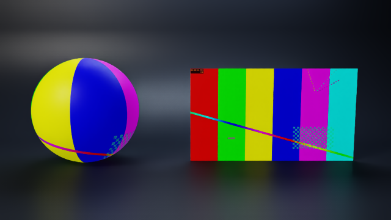

# Video textures with ovrtx (and Kit 110.4)

An `.mp4` bound to a material like any image texture plays on the surface. In Kit 110.4 that is all it takes; this
example renders the same scene headless with NVIDIA [ovrtx](https://github.com/nvidia-omniverse/ovrtx), to a still, an
MP4 or a GIF.



| File | What it is |
| --- | --- |
| `video_studio.usda` | Demo scene: a UV sphere and a 16:9 screen with an OmniPBR material, a studio set, `/World/Studio/Camera` |
| `textures/test_video.mp4` | The video: 10 s, 1280 × 720, 30 fps, a running timecode in its corner |
| `render_video.py` | Render a `.png`, `.mp4` or `.gif` with ovrtx, with the renderer clock kept on stage time |
| `pyproject.toml` | Pinned `ovrtx` / `ovstage`, plus `pillow` and `imageio-ffmpeg` for the output |
| `images/` | Sample render |

## The material

```usda
asset inputs:diffuse_texture = @./textures/test_video.mp4@ (
    colorSpace = "auto"
)
bool inputs:enable_emission = 1
asset inputs:emissive_color_texture = @./textures/test_video.mp4@ (
    colorSpace = "auto"
)
float inputs:emissive_intensity = 1000
```

Diffuse alone looks like a printed poster; emission makes the screen glow like a display. The sphere is a `Mesh` with
`primvars:st`: an implicit `Sphere` prim has no UVs, so a texture cannot map onto it. The timeline (0 to 240 at 24 time
codes per second) is the length of the clip.

## Run (PowerShell or cmd)

```powershell
uv sync
uv run python render_video.py video_studio.usda /World/Studio/Camera -o still.png --start 5
uv run python render_video.py video_studio.usda /World/Studio/Camera -o studio.mp4 --fps 30
uv run python render_video.py video_studio.usda /World/Studio/Camera -o studio.gif --fps 25 --end 3 --width 480 --height 270
```

In Git Bash, prefix the command with `MSYS_NO_PATHCONV=1` so `/World/Studio/Camera` is not rewritten into a Windows path.

### Windows: GStreamer plugins

ovrtx decodes video through GStreamer and loads the plugins only from its own package
(`ovrtx/bin/plugins/gpu.foundation/gstreamer-1.0`). The Linux wheels ship them; **the Windows wheel does not**, and
without them the first render step of a scene with a video texture blocks forever. `GST_PLUGIN_PATH` does not help:
GStreamer finds the plugins, but Windows refuses to load their DLL dependencies.

Kit has a matching set in the `omni.gpu_foundation` extension. Pass it once; the script copies it into ovrtx:

```powershell
uv run python render_video.py video_studio.usda /World/Studio/Camera -o still.png `
    --gstreamer <kit>\extscache\omni.gpu_foundation-<version>\bin\deps\gstreamer-1.0
```

(or set `GSTREAMER_PLUGINS`). A `uv sync` that reinstalls ovrtx removes the copy; pass the folder again. Keep the venv
at a short path: Windows does not load a plugin whose path exceeds 260 characters, and the render hangs again. The
plugin folder contains NVIDIA proprietary DLLs that come with Kit, so it is not part of this repo.

## Keeping the video in step

Video textures play on ovrtx's own clock, which every `step(delta_time=...)` advances, not on USD time. With 8 warm-up
steps of 1/60 s per frame, a 30 fps animation shows the video four times too fast. `render_video.py` therefore

1. calls `renderer.reset(t0)` with the first frame's time,
2. passes the gap to the next frame's time as `delta_time` on that frame's first step,
3. passes `delta_time=0` on every other step, so the clock holds still while the frame converges.

## Tested

ovrtx 0.6.0 and ovstage 0.3.0 on Windows 11, RTX 6000 Ada. Matching the rendered screen against every frame of the source
video: a still at 5 s shows video frame 150; an MP4 from 1 s to 2 s at 30 fps shows frames 30, 45 and 57 at 1.0, 1.5 and
2.0 s (the decoder trails by a frame or so).
